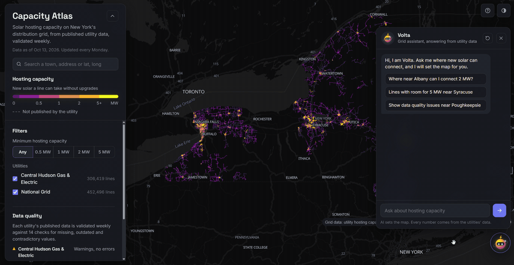
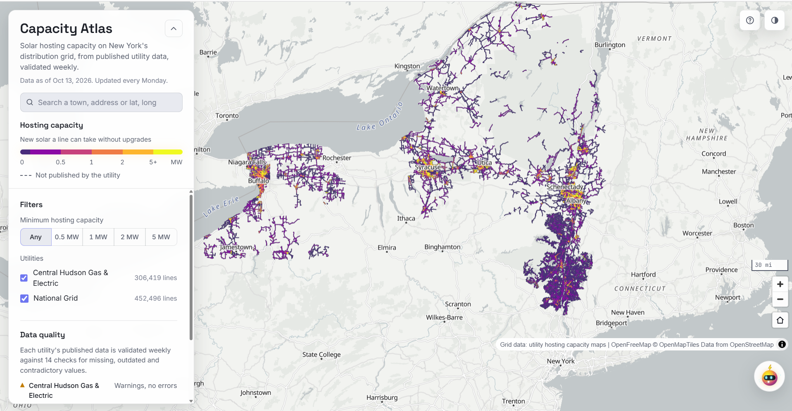
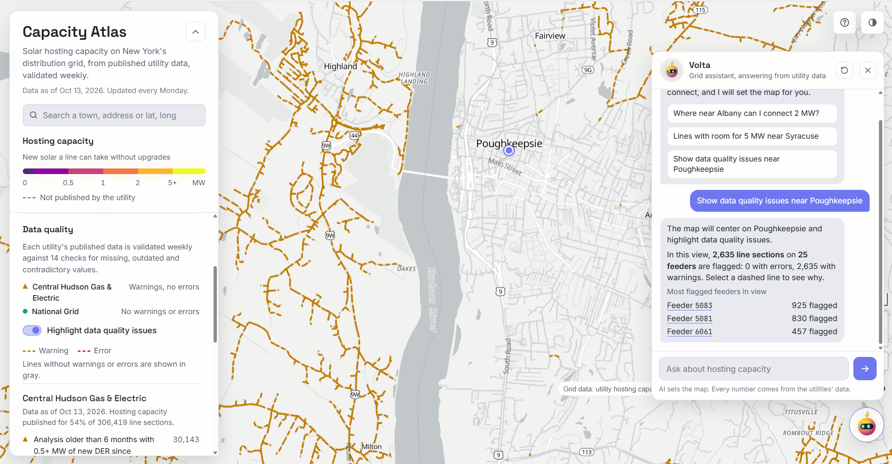
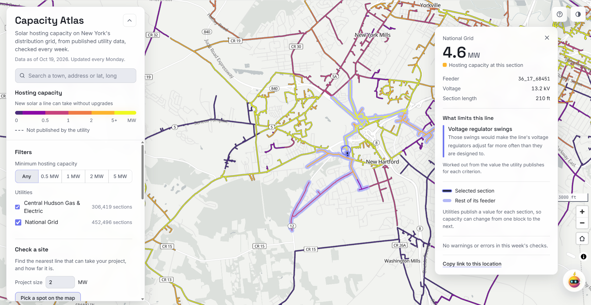
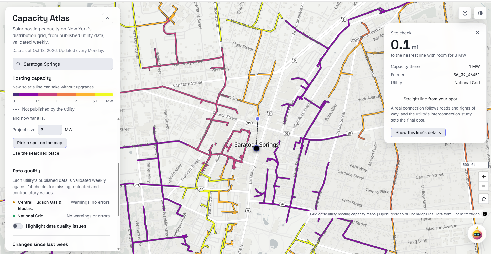
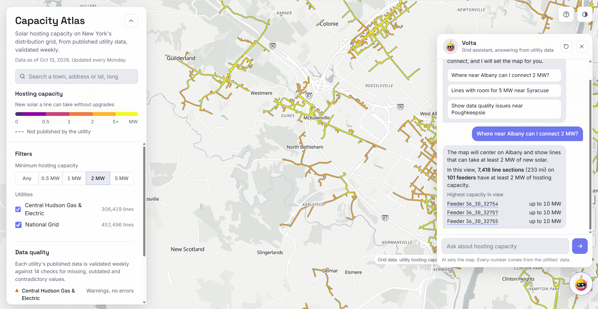
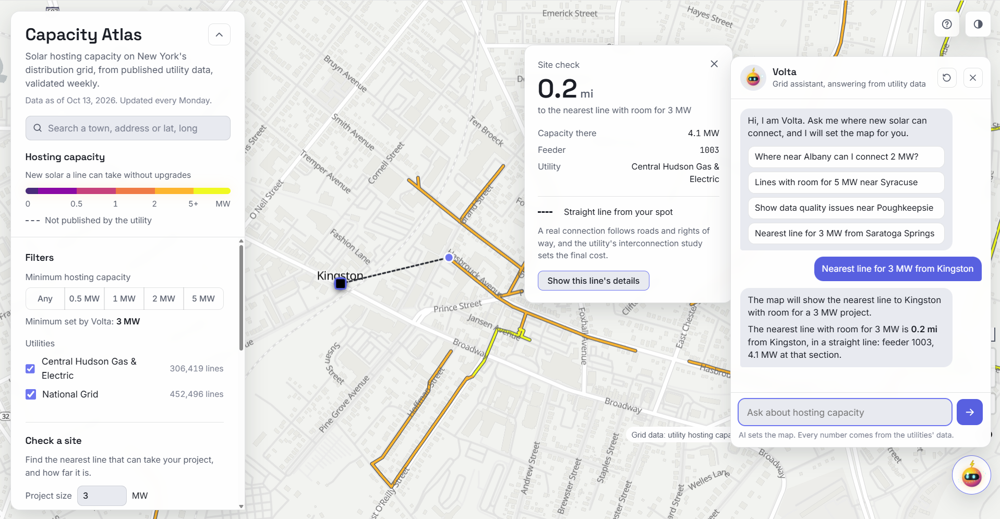
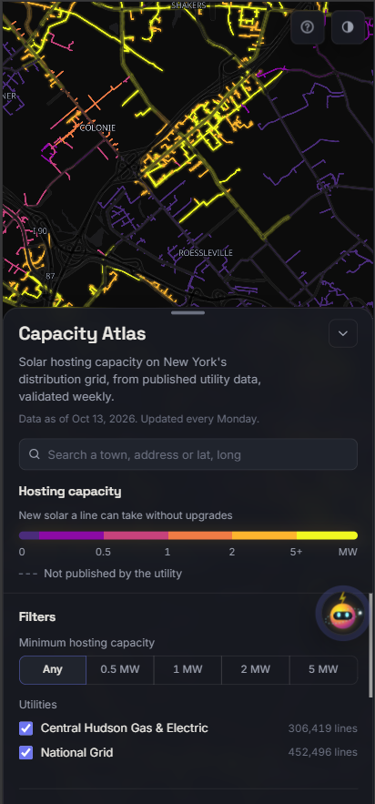
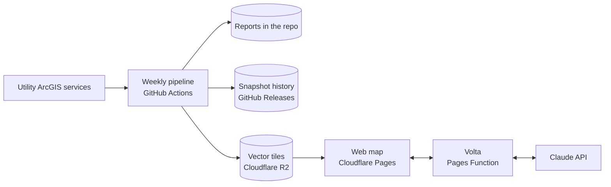

<div align="center">


### One map for two utilities, 14 data checks, updated every Monday

[](https://capacity-atlas.pages.dev)
[](https://github.com/SRINIVASRAVIKANTH/capacity-atlas/actions/workflows/tests.yml)
[](https://github.com/SRINIVASRAVIKANTH/capacity-atlas/actions/workflows/weekly-snapshot.yml)
<br>
[](https://www.python.org)
[](https://maplibre.org)
[](https://docs.claude.com)
[](LICENSE)

**[🗺️ Open the live map](https://capacity-atlas.pages.dev)** &nbsp;·&nbsp; [📊 This week's report](reports/LATEST.md) &nbsp;·&nbsp; [🏗️ Architecture](docs/architecture.md)

</div>

---

## 🌞 What is Capacity Atlas?

A new solar farm has to plug into a nearby power line. Some lines have room for more power,
and many are already full. Plugging into a full line can mean paying for upgrades that cost
more than the whole project.

Utilities in New York publish maps that show how much new solar each line can take. This is
called **hosting capacity**, measured in megawatts (MW). But every utility publishes its own
map in its own format, nobody keeps track of how the numbers change, and nobody checks them
for mistakes.

**Capacity Atlas fixes that.** Every Monday it:

1. 📥 **Collects** the hosting capacity data from Central Hudson and National Grid
2. ✅ **Checks** every record with 14 data quality rules
3. 🔄 **Compares** this week with last week and shows what changed on the map
4. 🗺️ **Publishes** both utilities on one free, public map

**Who it is for:** solar developers choosing land, landowners leasing it, and planners
looking for where the grid needs upgrades. Instead of opening two utility maps and
guessing, they see every line on one color scale, know which numbers look wrong, and can
simply ask the map a question in plain English.

<p align="center">
  
  <br><b>Figure 1.</b> Ask Volta a question in plain English. The map flies to Albany, keeps only lines with room for 2 MW, and counts them from the data.
</p>

<p align="center">
  
  <br><b>Figure 2.</b> 758,915 line sections from two utilities on one map. Yellow lines have the most room, purple the least.
</p>

---

## 🔍 What it found

| | Central Hudson | National Grid |
|---|---:|---:|
| ⚡ Line sections | 306,419 | 452,496 |
| 📈 Capacity published | 54% | 100% |
| ❌ Contradictory values | 0 | 0 |
| ⏳ Analysis older than 6 months, with new solar connected since | 30,143 sections, 31 feeders | |
| ❓ Feeder listed but substation missing | 8,716 sections, 22 feeders | |
| 🔒 Total capacity below every published limit | | 28,875 sections, 906 feeders |

Snapshot of October 9, 2026. The current week is in [`reports/LATEST.md`](reports/LATEST.md),
and every check is explained in [docs/data-quality.md](docs/data-quality.md).

<p align="center">
  
  <br><b>Figure 3.</b> Data quality highlight around Poughkeepsie. Lines with issues stay in color, the rest turn gray, and the panel lists the feeders with the most problems.
</p>

---

## ✨ Features

| | Feature | What it does |
|---|---|---|
| 🗺️ | **One map, two utilities** | 758,915 line sections on one color scale, filtered by minimum capacity and by utility |
| 📍 | **Site check** | Enter a project size and pick a spot or search an address. The map finds the nearest line with enough room, draws the link and gives the distance |
| 🔗 | **Share and download** | Copy a link that reopens a site check for a colleague, or save the lines in view, with the filters applied, as a CSV spreadsheet or a GeoJSON map file |
| 🔎 | **Two levels of detail** | Zoomed out, a click selects a whole feeder and shows its capacity range. Zoomed in, a click shows one section's value, length, voltage, phases, analysis date and data issues |
| ✅ | **Weekly validation** | 14 checks, from impossible values to analyses that new solar has made outdated |
| 🔄 | **Changes since last week** | Each week is compared with the one before, section by section. Lines that gained or lost capacity, or are new, can be highlighted on the map |
| 🕰️ | **History** | Every weekly snapshot is kept as GeoParquet in the repository's releases, with a report of what changed |
| 🤖 | **Volta, the assistant** | Ask "Where near Albany can I connect 2 MW?" or "How far is the nearest line for 3 MW from Troy?" and the map moves, filters and measures itself |
| ♿ | **Built for everyone** | Light and dark themes, a color blind safe scale, severity shown by shape as well as color, keyboard support and a phone layout |

<p align="center">
  
  <br><b>Figure 4.</b> One selected section. Its whole feeder is outlined, and the card shows the published values and any data issues.
</p>

<p align="center">
  
  <br><b>Figure 5.</b> Site check from the panel. A 3 MW project in Saratoga Springs is 0.1 mi from a line that can take it, shown by the dashed link.
</p>

<p align="center">
  
  <br><b>Figure 6.</b> Volta turns a question into map settings. Every number in the answer is counted from the data on screen, not written by the AI.
</p>

<p align="center">
  
  <br><b>Figure 7.</b> Volta runs the same site check from a plain question. The nearest line with room for 3 MW is 0.2 mi from Kingston, on a Central Hudson feeder.
</p>

<p align="center">
  
  <br><b>Figure 8.</b> Dark theme on a phone.
</p>

---

## ⚙️ How it works



Every Monday a GitHub Actions run downloads each utility's full layer, saves a snapshot,
runs the checks, compares with the previous week, builds one PMTiles file and uploads it to
Cloudflare R2. The site is static HTML, CSS and JavaScript on Cloudflare Pages, and it reads
only the map tiles in view, straight from R2. Details are in
[docs/architecture.md](docs/architecture.md).

---

## 🧠 Design decisions

* 🎯 **The AI never states numbers.** Claude is called with one forced tool that returns a
  place, a minimum size, a utility, whether to run the site check and a short sentence. The
  browser computes every count and distance from the data, so answers stay grounded and each
  question costs a fraction of a cent.
* 🧩 **Each utility's schema is mapped, not assumed.** A `ColumnMap` per source translates
  different column names into one vocabulary, so checks and the map work the same way for
  every utility. Adding a utility is one entry plus a test.
* 🛡️ **A failure in one utility never blocks the others.** Each source runs on its own, and
  the map keeps the last good snapshot of any utility that fails. A download that comes back
  empty, or with under half of last week's lines, is treated as a failure, so a server glitch
  never wipes a utility off the map.
* 🧱 **Built to extend.** Collectors and quality checks are abstract base classes. A utility on
  another platform gets its own `Collector` subclass, and a new check is one `QualityRule`
  subclass; the pipeline, reports and map pick them up unchanged.
* 💸 **Free to run.** GitHub, Cloudflare Pages and R2 free tiers, free basemaps and search.
  The only cost is the assistant, capped by prepaid credit.
* 🔐 **Secure by default.** The Claude key is an encrypted Cloudflare secret. The function
  accepts only the site's own origin, caps question and body size, times out slow calls and
  rate limits each visitor. The site sends a strict Content Security Policy, and every value
  from the utilities or the AI is shown as text, never as HTML. Details in
  [SECURITY.md](SECURITY.md).

---

## 🛠️ Tech stack

| Area | Tools |
|---|---|
| 📥 Data collection and processing | Python 3.12, Requests, GeoPandas, Shapely, PyArrow, GeoParquet |
| ✅ Validation and history | Rule classes in Python, snapshot comparison by section ID |
| 🔁 Automation | GitHub Actions (weekly run and tests), GitHub Releases |
| 🧱 Map data | tippecanoe, PMTiles, Cloudflare R2 |
| 🗺️ Web map | MapLibre GL JS, PMTiles, OpenFreeMap, Photon, plain HTML, CSS and JavaScript |
| 🤖 Assistant | Cloudflare Pages Functions, Claude API (Haiku) with tool use |
| 🧪 Testing and quality | pytest (76 tests, 89% coverage), Node test runner for the assistant function, Ruff and ESLint, all run on every push |

---

## 📁 Repository

```
capacity_atlas/       Python package: collectors, sources, quality checks, changes, tiles, pipeline
functions/api/ask.js  The assistant's server function
web/                  The website, deployed as is
reports/              Weekly quality and change reports, written by the pipeline
tests/                Python and JavaScript tests
docs/                 Architecture, data quality and operations
scripts/              Diagnostic tools used while adding a utility
SECURITY.md           How the project is protected and how to report a problem
```

---

## 🚀 Run it locally

```
conda create -n capacity-atlas python=3.12 -y
conda activate capacity-atlas
pip install -r requirements.txt
pytest -q
python -m capacity_atlas.pipeline --all
```

Secrets, costs, adding a utility and known limits are covered in
[docs/operations.md](docs/operations.md).

---

## 📋 Data and limits

Hosting capacity values are estimates published by each utility for early screening. They
do not replace a utility interconnection study. Data sources: Central Hudson Gas & Electric
and National Grid public hosting capacity services. Basemap by OpenFreeMap with
OpenMapTiles and OpenStreetMap data; place search by Photon.

## 📄 License

Code under the [MIT License](LICENSE). The data belongs to the utilities that publish it.

---

<div align="center">

Built by **[Srinivas Ravikanth](https://github.com/SRINIVASRAVIKANTH)** 🌞

</div>
