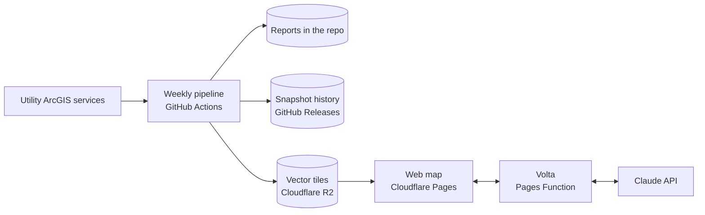

# Capacity Atlas

Where New York's power lines have room for new solar, from the utilities' own hosting
capacity data, validated every week.

**[Open the live map](https://capacity-atlas.pages.dev)**


[](https://github.com/SRINIVASRAVIKANTH/capacity-atlas/actions/workflows/tests.yml)
[](https://github.com/SRINIVASRAVIKANTH/capacity-atlas/actions/workflows/weekly-snapshot.yml)

## The problem

A solar project has to connect to a nearby distribution line, and many lines are already full.
Connecting to a full line means paying for upgrades that can cost more than the project is
worth. New York requires utilities to publish hosting capacity maps, but each utility publishes
its own map in its own format, nobody tracks how the numbers change, and nobody checks them.

Capacity Atlas collects that data every week, puts both utilities on one map, compares each
week with the last, and flags records that are missing, outdated or contradictory, so a
developer knows which numbers to trust before buying land.

## What it found

| | Central Hudson | National Grid |
|---|---:|---:|
| Line sections | 306,419 | 452,496 |
| Capacity published | 54% | 100% |
| Contradictory values | 0 | 0 |
| Analysis older than 6 months with new solar connected since | 30,143 sections, 31 feeders | |
| Feeder listed but substation missing | 8,716 sections, 22 feeders | |
| Total capacity below every published limit | | 28,875 sections, 906 feeders |

Snapshot of October 9, 2026. The current week is in [`reports/LATEST.md`](reports/LATEST.md),
and every check is described in [docs/data-quality.md](docs/data-quality.md).


## Features

* **One map for two utilities.** 758,915 line sections on one color scale, filtered by minimum
  capacity and by utility.
* **Two levels of detail.** Zoomed out, a click selects a whole feeder and shows its capacity
  range. Zoomed in, a click selects one section and shows its value, length, voltage, phases,
  analysis date and any data issues.
* **Weekly validation.** 14 checks, from impossible values to analyses that new solar has
  outdated. Problem lines can be highlighted on the map.
* **History.** Every weekly snapshot is kept as a GeoParquet file in the repository's releases,
  with a report of what changed since the week before.
* **Volta, the assistant.** Ask "Where near Albany can I connect 2 MW?" and the map moves and
  filters itself. Claude only turns the question into map settings; every number in the reply
  is counted from the published data on screen.
* **Built for everyone.** Light and dark themes that follow the system setting, a color blind
  safe scale, severity shown by shape as well as color, keyboard support, and a phone layout.


<p align="center"></p>

## How it works



Every Monday a GitHub Actions run downloads each utility's full layer, saves a snapshot,
runs the checks, compares with the previous week, builds one PMTiles file and uploads it to
Cloudflare R2. The site is static HTML, CSS and JavaScript on Cloudflare Pages. It reads only
the map tiles in view, straight from R2. Details are in [docs/architecture.md](docs/architecture.md).

## Design decisions

* **The AI never states numbers.** Claude is called with one forced tool that returns a place,
  a minimum size, a utility and a short sentence. The browser computes every count from the
  data. Answers stay grounded, and each question costs a fraction of a cent.
* **Each utility's schema is mapped, not assumed.** A `ColumnMap` per source translates
  different column names into one vocabulary, so checks and the map work the same way for
  every utility. Adding a utility is one entry plus a test.
* **A failure in one utility never blocks the others.** Each source runs on its own, and the
  map keeps the last good snapshot of any utility that fails.
* **Free to run.** GitHub, Cloudflare Pages and R2 free tiers, free basemaps and search. The
  only cost is the assistant, capped by prepaid credit.
* **Secrets stay server side.** The Claude key is an encrypted Cloudflare secret. The function
  accepts only the site's own origin, limits question length and rate limits each visitor.

## Tech stack

| Area | Tools |
|---|---|
| Data collection and processing | Python 3.12, Requests, GeoPandas, Shapely, PyArrow, GeoParquet |
| Validation and history | Rule classes in Python, snapshot comparison by section ID |
| Automation | GitHub Actions (weekly run and tests), GitHub Releases |
| Map data | tippecanoe, PMTiles, Cloudflare R2 |
| Web map | MapLibre GL JS, PMTiles, OpenFreeMap, Photon, plain HTML, CSS and JavaScript |
| Assistant | Cloudflare Pages Functions, Claude API (Haiku) with tool use |
| Testing | pytest (56 tests), Node test runner, Playwright for visual checks |

## Repository

```
capacity_atlas/       Python package: collectors, sources, quality checks, changes, tiles, pipeline
functions/api/ask.js  The assistant's server function
web/                  The website, deployed as is
reports/              Weekly quality and change reports, written by the pipeline
tests/                Python and JavaScript tests
docs/                 Architecture, data quality and operations
scripts/              Diagnostic tools used while adding a utility
```

## Run it locally

```
conda create -n capacity-atlas python=3.12 -y
conda activate capacity-atlas
pip install -r requirements.txt
pytest -q
python -m capacity_atlas.pipeline --all
```

Secrets, costs, adding a utility and known limits are covered in
[docs/operations.md](docs/operations.md).

## Data and limits

Hosting capacity values are estimates published by each utility for early screening. They
do not replace a utility interconnection study. Data sources: Central Hudson Gas & Electric
and National Grid public hosting capacity services. Basemap by OpenFreeMap with
OpenMapTiles and OpenStreetMap data; place search by Photon.

## License

Code under the [MIT License](LICENSE). The data belongs to the utilities that publish it.

Built by [Srinivas Ravikanth](https://github.com/SRINIVASRAVIKANTH).
