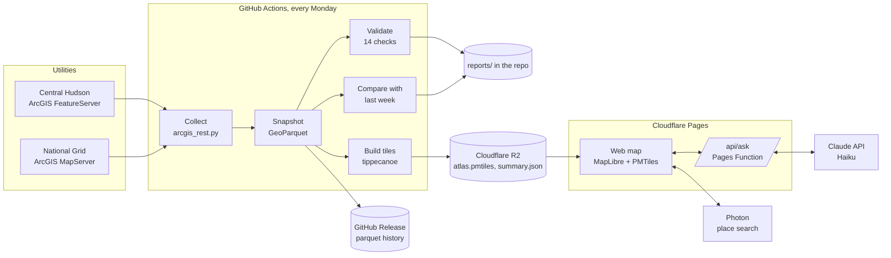

# Architecture

Capacity Atlas has three parts: a weekly pipeline that runs on GitHub Actions, a static
web map hosted on Cloudflare Pages, and one small server function that connects the map's
assistant to the Claude API.

## Weekly pipeline

| Step | Code | Output |
|---|---|---|
| Download every line section, in batches, with retries and polite pauses | `capacity_atlas/collectors/arcgis_rest.py` | GeoDataFrame |
| Refuse a broken download: empty, or under half the rows of the last good snapshot | `capacity_atlas/pipeline.py` | The previous snapshot stays in use |
| Save a dated snapshot, written to a temporary file and then renamed, so a stopped run never leaves half a file | `capacity_atlas/snapshot.py` | `data/snapshots/<source>/<date>.parquet` and `.meta.json` |
| Run the data checks | `capacity_atlas/quality/` | `reports/<source>/<date>.quality.md` and `.json` |
| Compare with the previous snapshot by the utility's own section ID | `capacity_atlas/changes.py` | `reports/<source>/changes/<old>_to_<new>.md` |
| Summarize the run | `capacity_atlas/pipeline.py` | `reports/LATEST.md` |
| Add the week to the feeder capacity history | `capacity_atlas/history.py` | `reports/history/feeder_capacity.json`, uploaded as `history.json` |
| Build the map data | `capacity_atlas/tiles.py` | `atlas.pmtiles`, `summary.json` |

One utility failing never stops the others, and one broken quality check never hides the
results of the other checks. The run is marked failed at the end so the problem is visible in
the Actions tab.

Last week's snapshots come from the GitHub Releases. The run looks through recent releases
until it has one for every utility, because a release can be missing a utility whose download
failed that week.

### Classes

| Class | Role |
|---|---|
| `Collector` (abstract) | What every collector must do: `collect()` returns a GeoDataFrame. `ArcGISRestCollector` is the one used today; a utility on another platform gets its own subclass and nothing else changes. |
| `Source`, `ColumnMap` | One utility layer and the meaning of its columns. |
| `SnapshotStore` | Finds the latest snapshot of a source, and the one before a date, across this run and earlier releases. Used by the pipeline and the map build. |
| `QualityRule` (abstract) | Each of the 14 checks is a subclass with `required_columns()` and `check()`. `QualityChecker` runs any list of them. |
| `ChangeSummary` | The result of comparing two snapshots, written as the weekly change report. |
| `FeederHistory` | Every feeder's highest capacity on each snapshot date, added to week by week and saved compactly. |

Each utility publishes different column names. A `ColumnMap` in `capacity_atlas/sources.py`
translates them, so the checks, the comparison and the map all work on one shared vocabulary.
Adding a utility means adding one `Source` entry (see [operations.md](operations.md)).

## Map data

`tiles.py` writes one PMTiles file with two layers:

| Layer | Zooms | Content |
|---|---|---|
| `lines` | 11 and closer | Every section with capacity (`hc`), quality flags (`q`, `qs`), feeder, substation, voltage, phases, analysis date and length, plus the change since the previous snapshot (`ch`: more, less, new or withdrawn), the previous value (`hp`), and what limits the capacity (`lf`, see below). The tile feature id is a section number, so a selected section is highlighted whole across tile edges. |
| `overview` | 5 to 10 | Touching sections of one feeder in the same capacity band merged into continuous lines, plus feeder totals for the zoomed out card, including how many of its sections changed (`fc`). |

Quality flags are stored as a bit mask, one bit per check, in a fixed order (`FLAG_IDS`).
New checks are only ever added at the end so older files keep their meaning.

What limits a section (`capacity_atlas/limits.py`): National Grid publishes, next to the total,
the value each engineering criterion allows (voltage rise, voltage swings, regulator swings,
overload, islanding risk, flicker). The total is the lowest of them, so the lowest one is what
limits the line. `lf` is a bit mask of the criteria at that lowest value (ties are common). It is
left out where the total is below every criterion, because then an unpublished constraint sets
it (a quality check reports that), and where the lowest value is the 10 MW study ceiling, which
means "at least 10 MW", not a limit. The words for each bit are in `summary.json` under `limits`.
A utility that does not publish its criteria, such as Central Hudson, simply has no `lf`.

The card gives every National Grid line with a value an answer: the criteria named by `lf`;
"a limit the utility does not publish" where the quality flag says the total is below every
criterion; or "nothing up to 10 MW" at the study ceiling. The CSV's "Limited by" column uses
the same words.

PMTiles is a single file read with HTTP range requests, so the browser downloads only the
tiles in view. It is served from Cloudflare R2 because R2 allows cross-origin range requests
and charges nothing for downloads.

## Capacity history

The map shows one week; the history shows how each feeder moves over time. For every feeder
and snapshot date, `capacity_atlas/history.py` keeps the feeder's highest published capacity,
the best spot a project could find on it.

* Stored in the repository as `reports/history/feeder_capacity.json`, so every version is in
  git, and uploaded to R2 as `history.json` for the site.
* Each feeder keeps only the dates where its value changed, as `[date index, value]` pairs.
  Most feeders stay the same for weeks, so the file stays near 50 KB.
* Each run adds any snapshot date the history lacks. On the first run that means every
  earlier release; afterwards only the new week. A date added twice replaces the old point,
  and a damaged file or snapshot costs one point, never the run.
* Two years of dates are kept.
* The site loads the file once, after the map has drawn. The feeder card (zoomed out) draws
  the trend as a small chart, and the section card adds one "Feeder trend" line. Both appear
  only from 4 dates on, because fewer is not a trend. The browser checks the file's shape and
  shows nothing if anything is off (`web/history.js`).

## Web map

Plain HTML, CSS and JavaScript with no build step. MapLibre GL JS and the PMTiles reader are
bundled in `web/vendor`, fonts in `web/fonts`, so the site depends on no CDN.

* Basemaps: OpenFreeMap (free, no key), one style per theme.
* Place search: Photon over OpenStreetMap, called only when the person presses Enter.
* Security headers and a Content Security Policy are set in `web/_headers`: scripts load only
  from the site itself, and data only from R2, OpenFreeMap and Photon.
* Every number shown, including the assistant's counts, is computed in the browser from the
  tiles currently on screen.
* Motion is short and only on arrival: cards slide in, popovers drop in, Volta's chat grows
  out of its button, and the data credits glow once on load and fold away after 30 seconds.
  People who ask their system for reduced motion get none of it.
* The detail card always stays left of the column of map buttons (zoom, home, Volta), so it
  never covers them. With the chat open, the card sits beside it with a 12px gap; on screens from 1020 to
  1139px both get narrower, and below 1020px they stack on the right.
* The map is always flat and north up: tilting and turning are switched off for the mouse,
  touch and keyboard, and an old link that asks for a tilted view opens flat at its own place.
* Site check (`findNearestLine` in `app.js`, distance math in `geo.js`): the nearest line with
  room for a project. It first searches the sections in the tiles around the spot; a result
  nearer than the edge of the loaded area is certainly the nearest. Otherwise it searches the
  overview layer over a much wider area, where each merged line knows its feeder's highest
  value, then zooms in on the best feeder to find the exact section. Distances are straight
  lines on a local flat projection, within 0.5% of the great-circle distance up to 100 km.
* Shared site checks (`parseSiteLink` and `siteLink` in `export.js`): the result card copies a
  link such as `?site=-73.78461,43.08311&mw=3`. Opening it reruns the check once, then the
  address bar drops it so a reload starts clean. The link is read strictly: two plain numbers
  inside New York and a size from 0.1 to 10,000 MW, or it is ignored. It carries nothing else,
  so it needs no server and does not expire.
* Download (`downloadView` in `app.js`, file helpers in `export.js`): the line sections in view,
  with the filters applied, as CSV or GeoJSON. Built in the browser from the tiles already
  loaded, so it costs no server work. Pieces of a section split by tile edges are joined by
  section id, sections outside the view are dropped, and the file is capped at 25,000 sections.
  Columns are the values shown on the map, in words: data quality issues by title, changes as
  "More capacity" and so on. Internal codes (section numbers, flag bits) are left out. Shapes
  are the simplified tile shapes, which the GeoJSON metadata says.

## Assistant (Volta)

`functions/api/ask.js` is a Cloudflare Pages Function at `/api/ask`.

1. The browser sends the question.
2. The function calls Claude with one forced tool, `set_map_view`, so the reply is always
   structured: place, minimum MW, utility, whether to show data issues, whether to run the
   site check, and one sentence.
3. The function cleans the result to known fields and values and returns it.
4. The browser applies the settings, flies to the place, waits for the map to render,
   then counts sections, miles and feeders from the data on screen, or, for a site check,
   measures the distance to the nearest line with room.

Follow-ups: the browser keeps the last three questions of the chat and the settings chosen
for each, only in the open page, and sends them with the next question. The function checks
them like a question (length caps, settings cleaned to known fields, malformed turns dropped)
and passes them to Claude as its own earlier tool calls, so "and for 5 MW?" keeps the place.
The AI's earlier replies are never sent back. "New chat" clears the memory.

The model never states capacity values. That keeps answers grounded in the published data
and keeps each call small and cheap.

Safeguards: the API key exists only as an encrypted Cloudflare secret; only the site's own
origin may call the function; questions are capped at 300 characters and the whole request at 4 KB; each visitor is limited
to 6 questions a minute and 60 a day; prepaid API credit with auto reload off caps spending.
