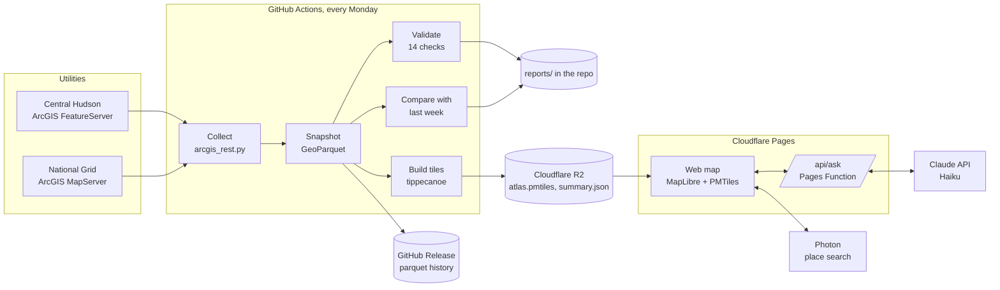

# Architecture

Capacity Atlas has three parts: a weekly pipeline that runs on GitHub Actions, a static
web map hosted on Cloudflare Pages, and one small server function that connects the map's
assistant to the Claude API.

## Weekly pipeline

| Step | Code | Output |
|---|---|---|
| Download every line section, in batches, with retries and polite pauses | `capacity_atlas/collectors/arcgis_rest.py` | GeoDataFrame |
| Save a dated snapshot | `capacity_atlas/snapshot.py` | `data/snapshots/<source>/<date>.parquet` and `.meta.json` |
| Run the data checks | `capacity_atlas/quality/` | `reports/<source>/<date>.quality.md` and `.json` |
| Compare with the previous snapshot by the utility's own section ID | `capacity_atlas/changes.py` | `reports/<source>/changes/<old>_to_<new>.md` |
| Summarize the run | `capacity_atlas/pipeline.py` | `reports/LATEST.md` |
| Build the map data | `capacity_atlas/tiles.py` | `atlas.pmtiles`, `summary.json` |

One utility failing never stops the others. The run is marked failed at the end so the
problem is visible in the Actions tab.

Each utility publishes different column names. A `ColumnMap` in `capacity_atlas/sources.py`
translates them, so the checks, the comparison and the map all work on one shared vocabulary.
Adding a utility means adding one `Source` entry (see [operations.md](operations.md)).

## Map data

`tiles.py` writes one PMTiles file with two layers:

| Layer | Zooms | Content |
|---|---|---|
| `lines` | 11 and closer | Every section with capacity (`hc`), quality flags (`q`, `qs`), feeder, substation, voltage, phases, analysis date and length. The tile feature id is a section number, so a selected section is highlighted whole across tile edges. |
| `overview` | 5 to 10 | Touching sections of one feeder in the same capacity band merged into continuous lines, plus feeder totals for the zoomed out card. |

Quality flags are stored as a bit mask, one bit per check, in a fixed order (`FLAG_IDS`).
New checks are only ever added at the end so older files keep their meaning.

PMTiles is a single file read with HTTP range requests, so the browser downloads only the
tiles in view. It is served from Cloudflare R2 because R2 allows cross-origin range requests
and charges nothing for downloads.

## Web map

Plain HTML, CSS and JavaScript with no build step. MapLibre GL JS and the PMTiles reader are
bundled in `web/vendor`, fonts in `web/fonts`, so the site depends on no CDN.

* Basemaps: OpenFreeMap (free, no key), one style per theme.
* Place search: Photon over OpenStreetMap, called only when the person presses Enter.
* Every number shown, including the assistant's counts, is computed in the browser from the
  tiles currently on screen.

## Assistant (Volta)

`functions/api/ask.js` is a Cloudflare Pages Function at `/api/ask`.

1. The browser sends the question.
2. The function calls Claude with one forced tool, `set_map_view`, so the reply is always
   structured: place, minimum MW, utility, whether to show data issues, and one sentence.
3. The function cleans the result to known fields and values and returns it.
4. The browser applies the settings, flies to the place, waits for the map to render,
   then counts sections, miles and feeders from the data on screen.

The model never states capacity values. That keeps answers grounded in the published data
and keeps each call small and cheap.

Safeguards: the API key exists only as an encrypted Cloudflare secret; only the site's own
origin may call the function; questions are capped at 300 characters; each visitor is limited
to 6 questions a minute and 60 a day; prepaid API credit with auto reload off caps spending.
